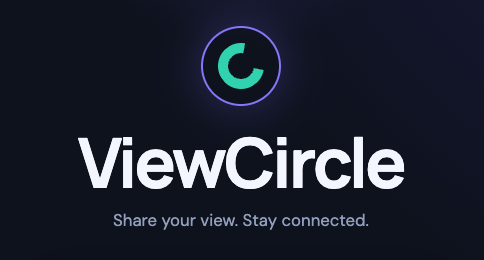
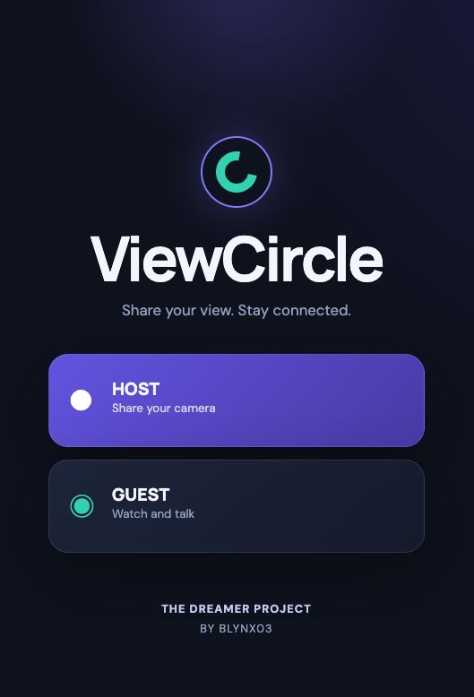
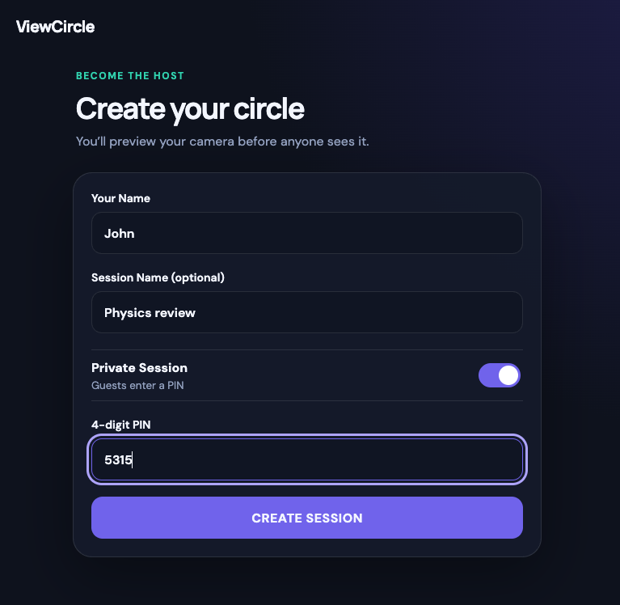
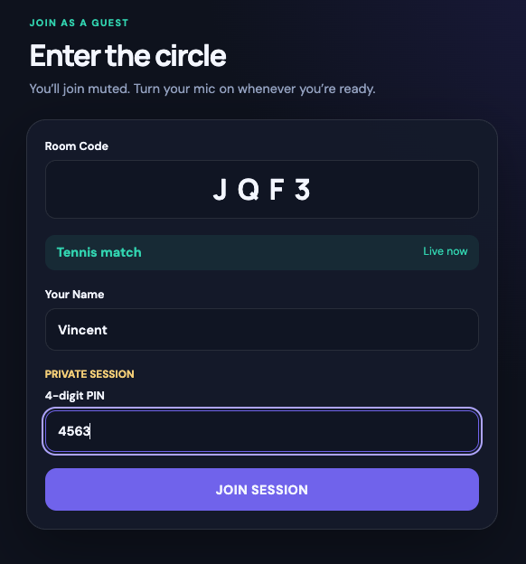
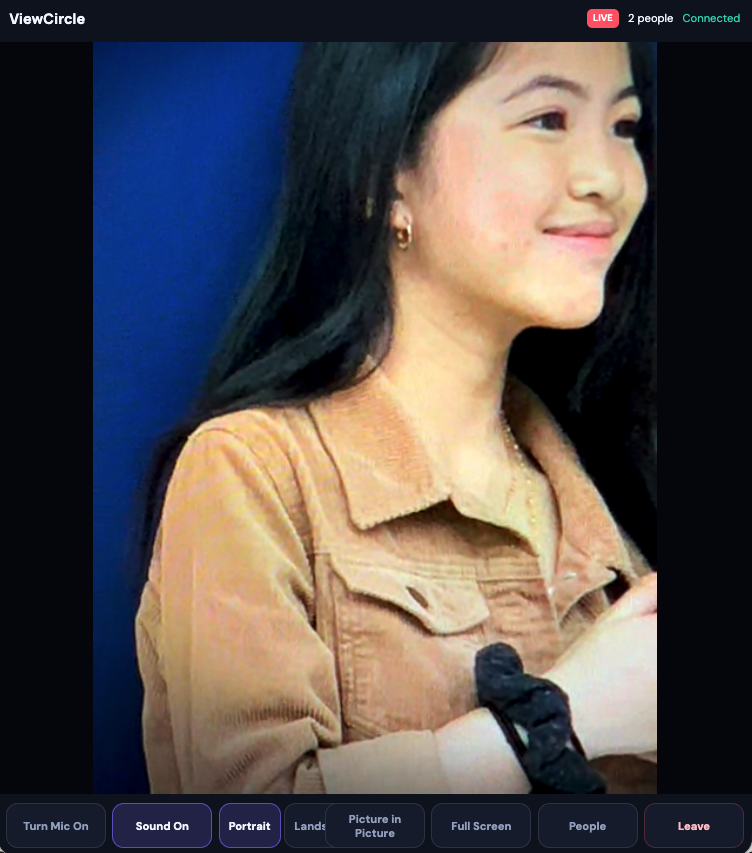
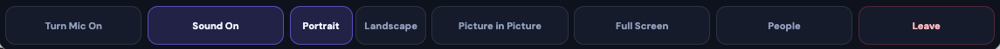
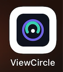
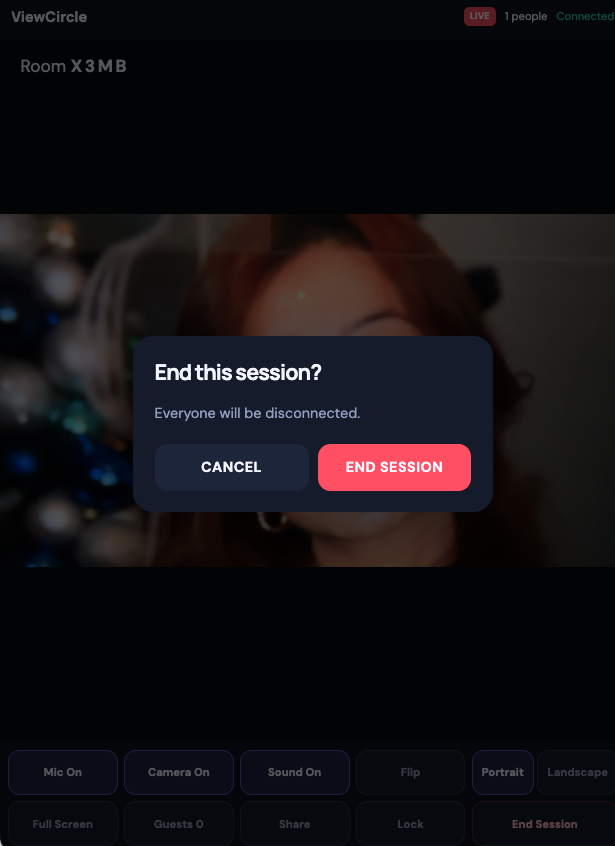

# 📹 ViewCircle — AI-Assisted Real-Time Video Application

**ViewCircle** is a real-time full-stack video communication application created primarily through an AI-assisted development workflow. It allows a host to create a private live session and invite guests using a short room code.

The host broadcasts live video and audio, while guests can watch the host and participate through voice communication. The application was designed with a mobile-first approach and supports desktop, tablet, and smartphone browsers.



ViewCircle demonstrates my ability to direct an AI coding agent throughout a complete software-development lifecycle. I defined the product requirements and expected behaviour, tested each iteration across devices, reproduced and documented defects, provided detailed feedback, and made the final product and user-experience decisions.

Codex generated most of the application code under my direction. The frontend uses React and Vite, while the backend uses Node.js and Express to manage secure room access and generate LiveKit access tokens. LiveKit Cloud provides the WebRTC infrastructure for real-time video and audio communication. I validated the application through hands-on testing and directed its deployment to Vercel and Render.

---

## 📑 Table of Contents

* [Features](#-features)
* [Application Screens](#-application-screens)
* [Technologies Used](#-technologies-used)
* [Getting Started](#-getting-started)
* [Project Links](#-project-links)

---

## ✨ Features

* Simple host and guest entry options from the landing page.
* Private live sessions created using short and easy-to-share room codes.
* Secure room access using server-generated LiveKit tokens.
* Real-time host video and audio broadcasting through WebRTC.
* Guest voice participation with microphone mute and unmute controls.
* Guest camera publishing is prevented so the host remains the primary video broadcaster.
* Host controls for selecting the front or rear camera on supported mobile devices.
* Portrait and landscape viewing preference with session-level persistence.
* Fullscreen viewing support on compatible browsers and devices.
* Picture-in-Picture support when permitted by the device and browser.
* Installed iOS detection with Safari guidance when Picture-in-Picture is unavailable in the installed web app.
* Copy-session-link functionality that preserves the guest name and room code without including private credentials.
* Foreground recovery when a guest returns to the application after switching apps.
* Host-controlled session termination with a clear session-ended message for connected guests.
* Responsive, mobile-first interface optimized for smartphones, tablets, and desktop browsers.
* Progressive Web App support for installation on compatible devices.
* Automated frontend and backend tests generated with AI assistance, complemented by hands-on testing across desktop and mobile devices.

---

## 📸 Application Screens

- **Landing Page** — Simple entry point for starting a session as a host or joining an existing session as a guest.



The responsive landing page provides clearly separated host and guest actions.

- **Host Setup** — Session creation interface for entering a host name and preparing a private room.



The host creates a live session and receives a short room code that can be shared with guests.

- **Guest Join** — Streamlined interface for entering a display name and room code.



Guests can join a live room using the code supplied by the host without creating a permanent account.

- **Live Room** — Real-time video room where guests can watch and communicate with the host.



The room displays the host video and provides low-latency audio communication through LiveKit Cloud.

- **Session Controls** — Compact controls for microphone, camera selection, orientation, fullscreen, and session management.



The controls provide quick access to important session features while preserving space for the host video.

- **iOS Safari Handoff** — Browser-aware guidance for accessing supported Safari media features.



Installed iOS users can copy the session link and reopen it in Safari when browser-specific media functionality is required.

- **Session Ended** — Clear notification displayed to guests after the host ends the live session.



Guests are informed when the host closes the room and the live session is no longer available.

---

## 🛠️ Technologies Used

### Frontend

* HTML
* CSS
* JavaScript
* React
* Vite
* Progressive Web App Technologies

### Backend

* Node.js
* Express.js
* REST API

### Real-Time Communication

* LiveKit Cloud
* WebRTC
* WebSocket Communication

### Testing

* Vitest
* React Testing Library

### Cloud & Deployment

* Vercel — Frontend Deployment
* Render — Backend Deployment

### Development Tools & Workflow

* Git and GitHub
* AI-Assisted Development with Codex

---

## 🚀 Getting Started

To run the project locally, follow these steps:

### 1. Clone the Repository

```bash
git clone https://github.com/Blynx03/ViewCircle.git
cd ViewCircle
```

### 2. Install Backend Dependencies

```bash
cd backend
npm install
```

### 3. Configure the Backend Environment

Add the required LiveKit credentials and configuration values to the backend environment file. Use the variable names expected by the project and its environment example file, if provided.

Keep private LiveKit credentials on the backend and do not commit environment files containing secrets.

### 4. Start the Backend Development Server

```bash
npm run dev
```

### 5. Install Frontend Dependencies

Open another terminal in the project root:

```bash
cd frontend
npm install
```

### 6. Configure the Frontend Environment

Add the backend API URL to the frontend environment file using the variable name expected by the project.

### 7. Start the Frontend Development Server

```bash
npm run dev
```

Open the local URL displayed in the frontend terminal.

---

## 🔗 Project Links

* [GitHub Repository](https://github.com/Blynx03/ViewCircle)
